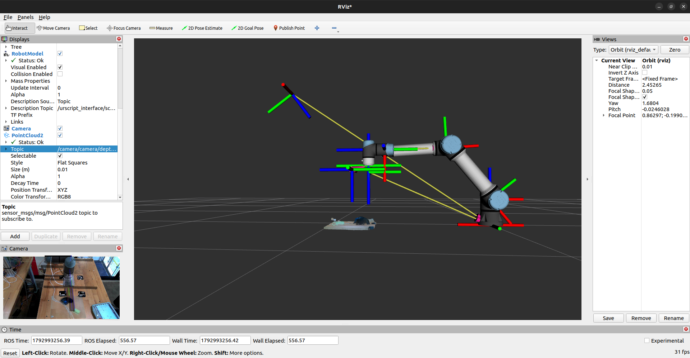
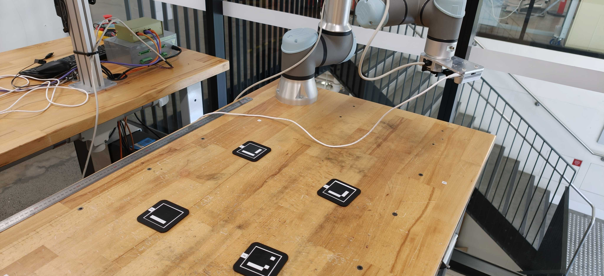

# UR5e camera calibration tools (ROS 2 Humble)
## Expected Results



*Expected RViz result after calibration*
Small, standalone Python/bash tools for calibrating the cameras on a lab UR5e:

- a **wrist camera** on the tool flange (we used an Intel RealSense), and
- a **fixed overhead camera** looking at the table (we used a Microsoft LifeCam Studio).

At the end, everything lives in one TF tree, so a pixel in either camera can be turned into a
position in `base_link`:

```
base_link ── ... ── tool0 ── camera_link ── camera_color_optical_frame     (wrist, via C3)
    └──────────────────────────────────────── overhead_cam_optical          (overhead, via C2)
```

Written for MTRN4231 (UNSW) by the DuploBot team. No ROS package to build: the scripts are plain
`python3` files that use rclpy, tf2_ros, cv_bridge and OpenCV's aruco module.

| Step | What it finds | Tool | How often |
|---|---|---|---|
| **C1** | Overhead camera intrinsics (focal length, distortion) | ROS `camera_calibration` + `check_overhead_calib.py` | Once per camera (redo if resolution/focus changes) |
| **C3** | Wrist camera on the flange (`tool0 → camera_link`) | `handeye_calib.py` | Once per mount (if the bracket moves, redo) |
| **C2** | Overhead camera in the robot frame (`base_link → overhead_cam_optical`) | `overhead_calib.py` | Every session / station (~5 min) |

The RealSense's own intrinsics come from its factory calibration (`/camera/camera/color/camera_info`); nothing to do there.

---

## Requirements

Ubuntu 22.04, ROS 2 Humble, and:
```bash
sudo apt install v4l-utils ros-humble-usb-cam ros-humble-camera-calibration \
  ros-humble-ur ros-humble-realsense2-camera python3-opencv
```
The scripts work with the apt OpenCV (4.5) and newer pip versions (4.7+). Note: OpenCV 5's Python
bindings have no `calibrateHandEye`; if you hit that, `pip install opencv-contrib-python==4.10.0.84`.

Clone the repo (or download the scripts) into one folder (e.g. `~/calib_tools/`) and run them from there. Not `~/Downloads`:
browsers rename re-downloads to `name (1).py`.

---

## Every session: start-up (one terminal each, leave them running)

Replace the IP with your robot's. Check the network first: `ping -c 3 <robot_ip>`.

```bash
# T1 overhead camera: locks the LifeCam settings, starts usb_cam on /overhead
./setup_overhead_cam.sh --launch

# T2 UR driver (RViz started separately, so an RViz crash can't take the driver down)
ros2 launch ur_robot_driver ur_control.launch.py ur_type:=ur5e robot_ip:=<robot_ip> launch_rviz:=false

# T3 wrist RealSense
ros2 launch realsense2_camera rs_launch.py pointcloud.enable:=true

# T4 wrist camera on the flange: paste YOUR line printed by C3
ros2 run tf2_ros static_transform_publisher --x ... --qw ... --frame-id tool0 --child-frame-id camera_link

# T5 overhead camera in the robot frame: paste YOUR line printed by C2
ros2 run tf2_ros static_transform_publisher --x ... --qw ... --frame-id base_link --child-frame-id overhead_cam_optical

# T6 RViz
rviz2
```
Start them one at a time. After T2, `ros2 topic hz /joint_states` should show ~500 Hz.
`static_transform_publisher` prints "Spinning until stopped" and sits there: that is correct.

**RViz:** Fixed Frame `base_link`; Add → RobotModel (Description Topic `/robot_description`); Add → TF;
optional PointCloud2 on `/camera/camera/depth/color/points` (Color Transformer `RGB8`, Size 0.003).
Save the layout (File → Save Config As) and start it later with `rviz2 -d your.rviz`.

---

## C1 – Overhead camera intrinsics

You need a flat checkerboard. Ours: 13×9 squares (= **12×8 inner corners**), 30 mm squares.

1. Lock the camera settings first (autofocus/auto-exposure off), otherwise the calibration won't hold.
   `setup_overhead_cam.sh` does this for a LifeCam Studio; re-tune its values for your lighting.
   LifeCam quirk: exposure only accepts 5, 10, 20, 39, 78, 156, …; anything else gives a white image.
2. With T1 running:
   ```bash
   ros2 run camera_calibration cameracalibrator --size 12x8 --square 0.030 \
     --ros-args -r image:=/overhead/image_raw -p camera:=/overhead
   ```
   Move the board everywhere (edges, corners, tilted, near and far) until the bars are green → **Calibrate** →
   **Save**. (Commit tends to hang with usb_cam: don't use it.)
3. Install the result where `usb_cam` loads it:
   ```bash
   mkdir -p ~/calib_overhead && cd ~/calib_overhead && tar -xzf /tmp/calibrationdata.tar.gz
   mkdir -p ~/.ros/camera_info && cp ost.yaml ~/.ros/camera_info/overhead.yaml
   sed -i 's/^camera_name:.*/camera_name: overhead/' ~/.ros/camera_info/overhead.yaml
   ```
4. Restart T1 and validate on **new** board positions (Ctrl+C prints a summary):
   ```bash
   python3 check_overhead_calib.py --board 12x8 --square 0.030
   ```
   Want a mean under ~0.5 px (we got 0.39 px). Over 1 px: redo the calibration.

---

## C3 – Wrist camera hand-eye (eye-in-hand)

Target: a printed AprilTag/ArUco grid or ChArUco board, taped flat to the table and **not touched** during capture.
Measure it with a ruler: the tag size is the **black square only**, and the pitch is centre to centre.

Needs T2 + T3 running (T4 not needed).
```bash
python3 handeye_calib.py identify            # optional: tells you the dictionary
python3 handeye_calib.py capture --target grid --dict DICT_APRILTAG_36h11 \
  --grid 5x7 --tag 0.020 --pitch-x 0.0305 --pitch-y 0.0305
```
In the image window: freedrive the arm → let go → wait 1–2 s → **c** (only when the status text is green).
Collect 15–20 **varied** poses: tilt 20–40° in different directions, rotate ±45°, heights 0.25–0.5 m.
**s** = solve, **u** = undo, **q** = save samples and quit. Re-solve later without the robot:
`python3 handeye_calib.py solve handeye_samples.json`.

- It runs all five OpenCV hand-eye methods, drops outlier samples, and prints a **board-consistency**
  number: the board's position in `base_link` for every sample should agree. Under ~2 mm mean is good.
- It prints a ready-made `static_transform_publisher` line for `tool0 → camera_link` → that's your T4.
- Tags printed rotated relative to OpenCV's corner order are detected automatically.
- Check: in RViz the point cloud should sit on the table and stay put while you freedrive.

---

## C2 – Overhead camera → robot frame
## C2 Setup



Uses the (already calibrated) wrist camera as a measuring tool: it measures where some markers are in
`base_link`, then the overhead camera's pose is solved from the same markers. Markers are only needed during
calibration; take them off the table afterwards.

**Markers:** 4 large ArUco markers (ours: `DICT_ARUCO_ORIGINAL`, IDs 0–3, 56 mm black square), in a rough
square that **surrounds your work area** but stays reachable by the wrist camera. Wider is more accurate.

Needs T1–T4 running.
```bash
python3 overhead_calib.py --dict DICT_ARUCO_ORIGINAL --size 0.056 --station bench1
```
1. **Fix the markers so they can't move** (tape/locating features). This was our #1 problem.
2. For each marker: freedrive the wrist camera ~30–40 cm above it, **marker in the centre of the wrist image**,
   let go, wait 2 s, press **c**. 2–3 captures per marker from slightly different spots. Each capture is compared
   with the earlier ones; if it's flagged BAD (> 5 mm off), press **u**.
3. **Move the arm out of the overhead camera's view**, press **o**. It averages 10 overhead frames and solves.
4. Read the checks:
   - reprojection < ~2–4 px;
   - **leave-one-out**: each marker's position predicted by the other three vs. where the wrist measured it.
     < 10 mm good, < 20 mm usable (we got 6–7 mm);
   - homography fit, pairwise marker distances (tape-measure them), capture spreads, per-marker jitter: these
     tell you *which* part is wrong if the result is bad (see troubleshooting).
5. **s** saves `overhead_<station>.yaml` with the publish command → that's your T5. Remove the markers.

Captures are saved as you go: after a crash, add `--resume`. **Check:** in RViz, Add → By topic →
`/overhead/image_raw` → **Camera**, Overlay Alpha 0.5. The robot model should sit on top of the real arm.

---

## Troubleshooting

| Symptom | Fix |
|---|---|
| `Package 'xyz' not found` | `sudo apt install ros-humble-xyz` (dashes), then open a new terminal |
| `static_transform_publisher: command not found` | It's `ros2 run tf2_ros static_transform_publisher ...` |
| usb_cam "not a valid V4L2 device /dev/../../video0" | Pass the resolved device (`readlink -f`); the setup script does this |
| Overhead image completely white | LifeCam exposure must be on its ladder: 5, 10, 20, 39, 78, 156… |
| `base_link` "frame does not exist" | UR driver not running |
| No `/joint_states` (`ros2 topic hz` silent) | Driver died: close everything, `pkill -f ros2; pkill -f rviz2; ros2 daemon stop`, start again one terminal at a time |
| Hand-eye window "No data yet" | RealSense not running, or different topic names (`--image`, `--info`) |
| Hand-eye reprojection error huge (tens of px) | Wrong `--tag`/`--pitch`: tag = black square only |
| Hand-eye result inconsistent | Board moved, or too little rotation between poses |
| C2 leave-one-out hundreds of mm, only some markers bad | Arm/hand covering a marker in the overhead view when pressing **o** |
| C2 all markers ~equally off, capture spreads > 5 mm | Markers moved during capture, or off-centre captures: fix the markers, recapture centred |
| C2 homography fit low but solve error high | Overhead intrinsics wrong (redo C1) or image size ≠ calibrated size (warned at start-up) |
| RViz "queue is full" / RViz or driver crashes | Laptop overloaded: run RViz separately, drop the point cloud display, lighter RealSense profile: `depth_module.depth_profile:=640x480x15 rgb_camera.color_profile:=640x480x15` |
| RealSense log shows "Stopping/Starting Sensor" by itself | USB reset: use a USB 3 port directly on the laptop, not a hub; keep the webcam on another port |
| UR driver: "calibration parameters ... don't match" | The robot's factory kinematics aren't loaded. Optional fix (a few mm): `ros2 launch ur_calibration calibration_correction.launch.py robot_ip:=<ip> target_filename:=$HOME/ur5e_calibration.yaml`, then add `kinematics_params_file:=...` to the driver launch and redo C3 |

## Reference values

Our own settings, intrinsics and transforms are in [`reference/REFERENCE.md`](reference/REFERENCE.md), for
sanity-checking yours (not for reuse: every camera, bracket and station differs).

## License

MIT (see `LICENSE`). Use, modify and share; a mention is appreciated.
